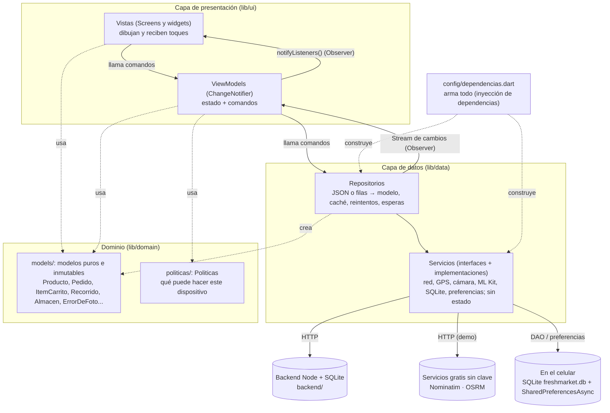
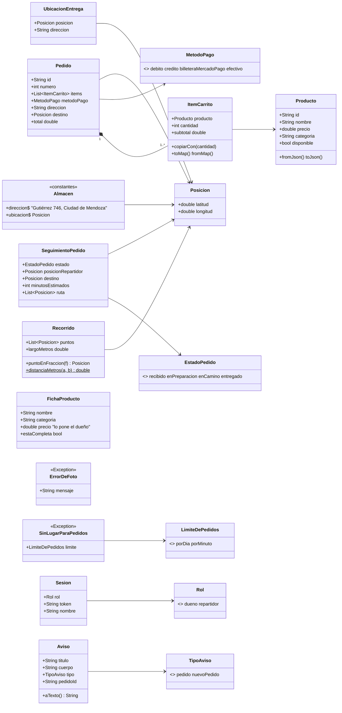
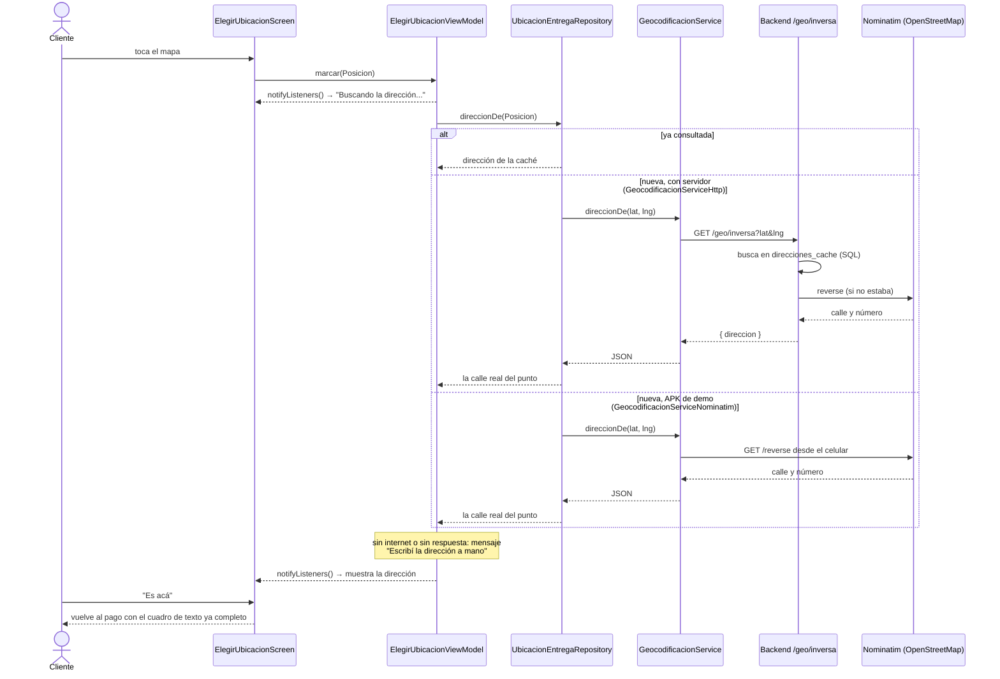
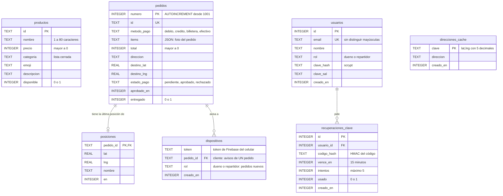
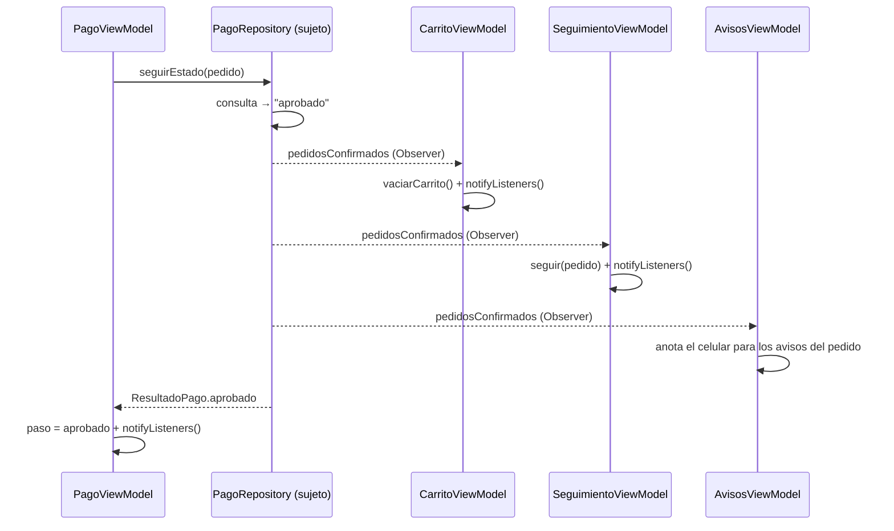
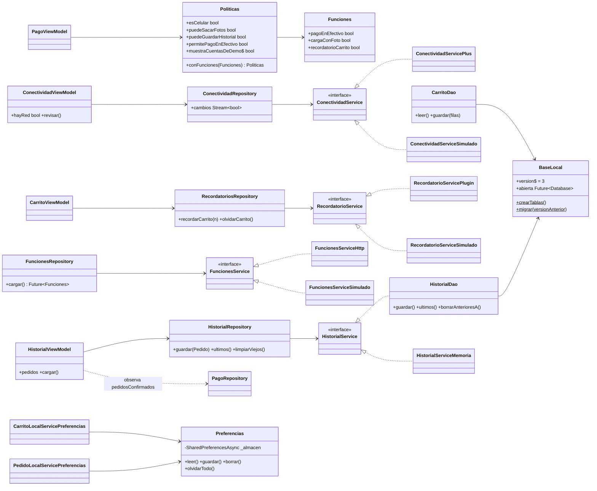
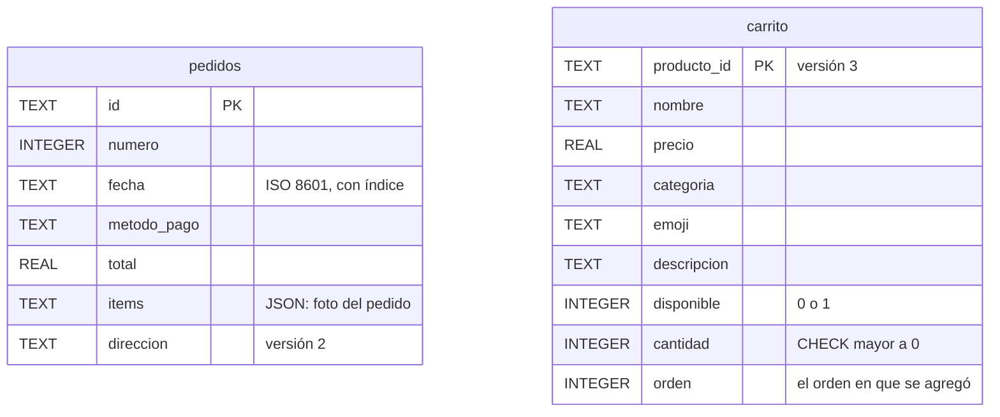
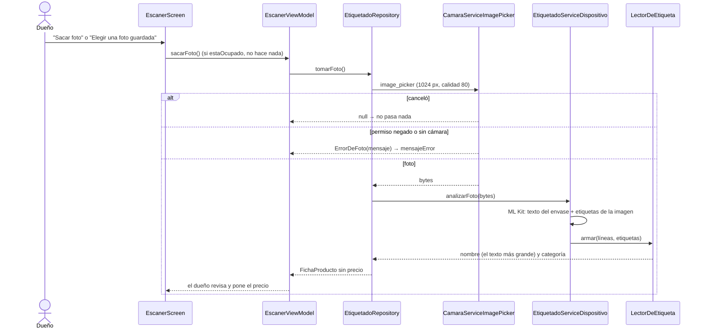

# Arquitectura de FreshMarket

Este documento muestra **cada clase en su capa**, cómo se conectan, el
modelo de datos SQL y cómo se recorre el ciclo completo de una acción.
Los diagramas están en Mermaid: GitHub y VS Code los dibujan solos. Las
mismas figuras, ya dibujadas, están en [`diagramas/`](diagramas/):
`capas.png`, `clases.png`, `modelos.png`, `secuencia_mapa.png`,
`base_de_datos.png` (servidor), `base_celular.png` (celular),
`secuencia_camara.png` y `presentacion_final.png`.

## 1. Capas

`dependencias.dart` arma la app de **dos maneras** sin que ninguna
pantalla se entere:

| Modo | Cuándo | Qué servicios usa |
|---|---|---|
| **Con servidor** | `--dart-define=URL_BACKEND=...` | Los `...Http` (catálogo, pago, seguimiento, sesión, foto con Gemini, dirección con caché) contra el backend propio |
| **Demo** (el APK de la defensa) | Sin `URL_BACKEND` | Los simulados para lo que necesita servidor (pago, pedidos), pero **datos reales** donde no hace falta clave: `GeocodificacionServiceNominatim` (la calle del punto), `RutaServiceOsrm` (el camino de la bici) y `EtiquetadoServiceDispositivo` (ML Kit lee la foto en el celular) |

En los dos modos se crea **una sola** `BaseLocal` (un archivo SQLite para
todas las tablas del celular), **una sola** `Preferencias` y **una sola**
`Politicas`, y se pasan a quien las necesita.

Reglas que se cumplen en todo el proyecto (y que se pueden verificar con
`grep`):

| Regla | Cómo se verifica |
|---|---|
| Ninguna vista habla con la red | `grep -rn "ApiClient\|http\." lib/ui` no devuelve nada |
| Ningún ViewModel importa `material.dart` ni recibe `BuildContext` | `grep -rln "material.dart" lib/ui/*/view_models` no devuelve nada |
| Ningún ViewModel importa la capa de servicios | `grep -rn "data/services" lib/ui/*/view_models` no devuelve nada |
| Los servicios no guardan estado de la app | Solo los simulados, que hacen de "servidor" (está comentado en cada uno) |
| Los repositorios no dependen entre sí | Cada uno recibe solo servicios en su constructor |
| Ningún ViewModel llama a otro ViewModel | Ningún constructor de ViewModel recibe otro ViewModel ni un callback `al...` hacia otro: se comunican observando repositorios (sección 6) |
| Encapsulamiento: estado privado, getters públicos, listas inmutables hacia afuera | Todos los campos que cambian empiezan con `_`; `items` devuelve `List.unmodifiable` |

## 2. Diagrama de clases

Para que se lea, cada interfaz de servicio aparece con sus
implementaciones (real y simulada) y cada pantalla con su ViewModel.
Las flechas punteadas con la etiqueta **observa** son suscripciones a un
`Stream` del repositorio (patrón Observer, sección 6).

```mermaid
classDiagram
    direction LR

    %% ---------- Vistas ----------
    class InicioScreen
    class CatalogoScreen
    class CarritoScreen
    class PagoScreen
    class ElegirUbicacionScreen
    class SeguimientoScreen
    class IngresarScreen
    class RecuperarClaveScreen
    class AlmacenScreen
    class EscanerScreen
    class RepartoScreen
    class CampoClave

    %% ---------- ViewModels ----------
    class NavegacionViewModel {
      -Seccion _actual
      +irA(Seccion)
    }
    class CatalogoViewModel {
      -List~Producto~ _productos
      +cargar()
      +buscar(String)
      +elegirCategoria(String)
    }
    class CarritoViewModel {
      -List~ItemCarrito~ _items
      +agregarProducto(Producto)
      +quitarProducto(Producto)
      +armarPedido(MetodoPago) Pedido
      +guardar()
      +restaurar()
    }
    class PagoViewModel {
      -MetodoPago _metodo
      -String _direccion
      -Posicion _destino
      +marcarDestino(Posicion, direccion)
      +pagar()
    }
    class ElegirUbicacionViewModel {
      -Posicion _punto
      -String _direccion
      +marcar(Posicion)
      +usarMiUbicacion()
      +resultado UbicacionEntrega
    }
    class SeguimientoViewModel {
      +seguir(Pedido)
    }
    class SesionViewModel {
      -Sesion _sesion
      +ingresar(email, clave)
      +salir()
    }
    class RecuperarClaveViewModel {
      +enviarCodigo(email)
      +cambiarClave(codigo, claveNueva, repetida)
    }
    class AlmacenViewModel
    class EscanerViewModel {
      -FichaProducto _ficha
      -String _mensajeError
      +estaOcupado bool
      +sacarFoto(deGaleria)
      +recuperarFotoPerdida()
      +cambiarPrecio(String)
      +guardar()
    }
    class RepartoViewModel
    class AvisosViewModel {
      +permisoDenegado bool
      +iniciar()
      +pedirPermiso()
    }

    %% ---------- Repositorios ----------
    class CatalogoRepository {
      -List~Producto~ _cache
      +cambios Stream~List~
    }
    class CarritoRepository {
      +guardar(List~ItemCarrito~)
      +cargar() List~ItemCarrito~
    }
    class PagoRepository {
      +pedidosConfirmados Stream~Pedido~
    }
    class NotificacionesRepository {
      +recibidos Stream~Aviso~
      +tocados Stream~Aviso~
      +seguirPedido(Pedido)
      +anotarCuenta()
      +olvidarCuenta()
    }
    class UbicacionEntregaRepository {
      -Map _cache
      +direccionDe(Posicion) String
      +miPosicion() Posicion
    }
    class SeguimientoRepository {
      +seguir(Pedido) Stream~SeguimientoPedido~
      +recordar(Pedido)
      +pedidoGuardado()
    }
    class SesionRepository {
      +cambios Stream~Sesion~
    }
    class EtiquetadoRepository {
      +tomarFoto(deGaleria) Uint8List
      +recuperarFotoPerdida() Uint8List
      +armarFicha(foto) FichaProducto
    }
    class RepartoRepository

    %% ---------- Servicios (interfaces) ----------
    class CatalogoService {<<interface>>}
    class CarritoLocalService {<<interface>>}
    class PagoService {<<interface>>}
    class CheckoutLauncher {<<interface>>}
    class GeocodificacionService {<<interface>>}
    class UbicacionService {<<interface>>}
    class SeguimientoService {<<interface>>}
    class SesionService {<<interface>>}
    class EtiquetadoService {<<interface>>}
    class CamaraService {
      <<interface>>
      +tomarFoto(deGaleria) Uint8List
      +recuperarPerdida() Uint8List
    }
    class RutaService {
      <<interface>>
      +rutaEntre(desde, hasta) Recorrido
    }
    class PedidoLocalService {<<interface>>}
    class RepartoService {<<interface>>}
    class PushService {<<interface>>}
    class NotificacionLocalService {<<interface>>}
    class AvisosService {<<interface>>}
    class ApiClient {
      -String _token
      +usarToken(String)
      +get() post() put() delete()
    }

    %% Vistas -> ViewModels
    InicioScreen --> NavegacionViewModel
    CatalogoScreen --> CatalogoViewModel
    CatalogoScreen --> CarritoViewModel
    CarritoScreen --> CarritoViewModel
    PagoScreen --> PagoViewModel
    PagoScreen ..> ElegirUbicacionScreen : abre
    ElegirUbicacionScreen --> ElegirUbicacionViewModel
    SeguimientoScreen --> SeguimientoViewModel
    IngresarScreen --> SesionViewModel
    IngresarScreen ..> RecuperarClaveScreen : abre
    IngresarScreen *-- CampoClave
    RecuperarClaveScreen --> RecuperarClaveViewModel
    RecuperarClaveScreen *-- CampoClave
    AlmacenScreen --> AlmacenViewModel
    EscanerScreen --> EscanerViewModel
    RepartoScreen --> RepartoViewModel
    SeguimientoScreen --> AvisosViewModel

    %% ViewModels -> Repositorios
    CatalogoViewModel --> CatalogoRepository
    AlmacenViewModel --> CatalogoRepository
    CarritoViewModel --> CarritoRepository
    PagoViewModel --> PagoRepository
    ElegirUbicacionViewModel --> UbicacionEntregaRepository
    SeguimientoViewModel --> SeguimientoRepository
    SesionViewModel --> SesionRepository
    RecuperarClaveViewModel --> SesionRepository
    EscanerViewModel --> EtiquetadoRepository
    EscanerViewModel --> CatalogoRepository
    RepartoViewModel --> RepartoRepository
    AvisosViewModel --> NotificacionesRepository

    %% Observer: ViewModels suscriptos a los repositorios
    CatalogoViewModel ..> CatalogoRepository : observa
    AlmacenViewModel ..> CatalogoRepository : observa
    AlmacenViewModel ..> SesionRepository : observa
    NavegacionViewModel ..> SesionRepository : observa
    NavegacionViewModel ..> NotificacionesRepository : observa
    RepartoViewModel ..> SesionRepository : observa
    RepartoViewModel ..> NotificacionesRepository : observa
    CarritoViewModel ..> PagoRepository : observa
    SeguimientoViewModel ..> PagoRepository : observa
    AvisosViewModel ..> PagoRepository : observa
    AvisosViewModel ..> SesionRepository : observa

    %% Repositorios -> Servicios
    CatalogoRepository --> CatalogoService
    CarritoRepository --> CarritoLocalService
    PagoRepository --> PagoService
    PagoRepository --> CheckoutLauncher
    UbicacionEntregaRepository --> GeocodificacionService
    UbicacionEntregaRepository --> UbicacionService
    SeguimientoRepository --> SeguimientoService
    SeguimientoRepository --> PedidoLocalService
    SesionRepository --> SesionService
    EtiquetadoRepository --> EtiquetadoService
    EtiquetadoRepository --> CamaraService
    RepartoRepository --> RepartoService
    RepartoRepository --> UbicacionService
    NotificacionesRepository --> PushService
    NotificacionesRepository --> NotificacionLocalService
    NotificacionesRepository --> AvisosService

    %% Implementaciones (Strategy: real o simulada)
    CatalogoService <|.. CatalogoServiceHttp
    CatalogoService <|.. CatalogoServiceLocal
    CarritoLocalService <|.. CarritoDao
    CarritoLocalService <|.. CarritoLocalServicePreferencias
    CarritoLocalService <|.. CarritoLocalServiceMemoria
    PedidoLocalService <|.. PedidoLocalServicePreferencias
    PedidoLocalService <|.. PedidoLocalServiceMemoria
    PagoService <|.. PagoServiceHttp
    PagoService <|.. PagoServiceSimulado
    CheckoutLauncher <|.. CheckoutLauncherExterno
    CheckoutLauncher <|.. CheckoutLauncherSimulado
    GeocodificacionService <|.. GeocodificacionServiceHttp
    GeocodificacionService <|.. GeocodificacionServiceNominatim
    GeocodificacionService <|.. GeocodificacionServiceSimulado
    UbicacionService <|.. UbicacionServiceGeolocator
    SeguimientoService <|.. SeguimientoServiceHttp
    SeguimientoService <|.. SeguimientoServiceSimulado
    SesionService <|.. SesionServiceHttp
    SesionService <|.. SesionServiceSimulado
    EtiquetadoService <|.. EtiquetadoServiceHttp
    EtiquetadoService <|.. EtiquetadoServiceDispositivo
    EtiquetadoService <|.. EtiquetadoServiceSimulado
    EtiquetadoServiceDispositivo --> LectorDeEtiqueta : ML Kit lee el envase
    CamaraService <|.. CamaraServiceImagePicker
    RutaService <|.. RutaServiceOsrm
    RutaService <|.. RutaServiceRecta
    RepartoService <|.. RepartoServiceHttp
    RepartoService <|.. RepartoServiceSimulado
    PushService <|.. PushServiceFirebase
    PushService <|.. PushServiceSimulado
    NotificacionLocalService <|.. NotificacionLocalServicePlugin
    AvisosService <|.. AvisosServiceHttp
    AvisosService <|.. AvisosServiceSimulado
    SeguimientoServiceSimulado --> PushServiceSimulado : manda avisos (demo)
    SeguimientoServiceSimulado --> RutaService : camino de la bici (demo)

    CatalogoServiceHttp --> ApiClient
    PagoServiceHttp --> ApiClient
    GeocodificacionServiceHttp --> ApiClient
    SeguimientoServiceHttp --> ApiClient
    SesionServiceHttp --> ApiClient
    EtiquetadoServiceHttp --> ApiClient
    RepartoServiceHttp --> ApiClient
    AvisosServiceHttp --> ApiClient
```

### Modelos de dominio

## 3. Ciclo completo: tocar el mapa y que aparezca la dirección

## 4. MVC y MVVM

La materia usa **MVVM**, que es la forma en que Flutter recomienda aplicar
la idea de **MVC** (Modelo–Vista–Controlador). Se corresponden así:

| MVC | En FreshMarket (MVVM) | Qué hace |
|---|---|---|
| **Modelo** | `domain/models` + `data/repositories` + `data/services` | Los datos y las reglas para obtenerlos y guardarlos |
| **Vista** | `ui/*/widgets` (Screens) | Dibuja el estado y avisa los toques |
| **Controlador** | `ui/*/view_models` (ViewModels) | Recibe las acciones, cambia el estado y avisa a la vista |

La diferencia es **cómo se entera la vista**: en MVC clásico el
controlador le dice a la vista qué cambiar; en MVVM la vista **observa** al
ViewModel (`ListenableBuilder` + `notifyListeners()`, patrón Observer) y se
redibuja sola. Así el ViewModel no conoce ningún widget y se puede probar
sin pantalla (por eso hay pruebas de cada ViewModel con fakes).

## 5. Modelo de datos (SQL)

El esquema completo está en [`backend/sql/schema.sql`](../backend/sql/schema.sql)
y los datos iniciales en [`backend/sql/seed.sql`](../backend/sql/seed.sql).
Se crea con `cd backend && npm run bd:crear`.

`dispositivos` tiene un `CHECK` para que cada fila sea **o** de un pedido
**o** de un rol (nunca las dos ni ninguna), y un índice único para que un
celular no se anote dos veces para lo mismo.

`productos` y `pedidos` no tienen clave foránea a propósito: el pedido
guarda una **foto** de los productos (nombre, precio y cantidad) en
`items`, para que si Don Ceferino cambia un precio o borra un producto,
los pedidos ya hechos no cambien.

## 6. Observer entre capas (desde el 07-11)

El Observer se usa en **dos niveles**:

1. **Vista ← ViewModel** (`ChangeNotifier` + `ListenableBuilder`): la vista
   se redibuja sola cuando el ViewModel llama a `notifyListeners()`.
2. **ViewModel ← Repositorio** (`Stream` de Dart): el repositorio es la
   única fuente de verdad y **publica** cada cambio; los ViewModels que lo
   necesitan se **suscriben** en su constructor y se **dan de baja** en
   `dispose()`.

| Sujeto (repositorio) | Qué publica | Quién observa |
|---|---|---|
| `CatalogoRepository.cambios` | La lista de productos cada vez que cambia | `CatalogoViewModel` ("Comprar"), `AlmacenViewModel` ("Mi almacén") |
| `SesionRepository.cambios` | La sesión al entrar, `null` al salir | `ApiClient` (token), `SesionViewModel`, `NavegacionViewModel`, `AlmacenViewModel`, `RepartoViewModel`, `AvisosViewModel` |
| `PagoRepository.pedidosConfirmados` | Cada pedido confirmado, una vez | `CarritoViewModel` (se vacía), `SeguimientoViewModel` (lo sigue), `AvisosViewModel` (anota el celular) |
| `NotificacionesRepository.recibidos` | Cada aviso que llega con la app abierta | `RepartoViewModel` (recarga la lista) |
| `NotificacionesRepository.tocados` | Cada notificación tocada | `NavegacionViewModel` (abre la sección) |

Los `StreamController` son `broadcast(sync: true)`: **broadcast** porque
hay varios observadores; **sync** para que todos se enteren en el mismo
momento en que cambia el dato (por ejemplo, el `ApiClient` ya tiene el
token cuando `ingresar()` termina).

Antes, los ViewModels se encadenaban con callbacks armados en `main.dart`
e `InicioScreen` (`alAprobar`, `alIngresar`, `alGuardar`,
`alCambiarCatalogo`, `alCambiarToken`). Funcionaba, pero cada pantalla nueva
obligaba a acordarse de llamar a todas las demás. Ahora quien produce el
cambio no sabe quién escucha.

Las pruebas de este comportamiento están en `test/observer_test.dart`.

## 7. Notificaciones push

Ver [`NOTIFICACIONES.md`](NOTIFICACIONES.md): qué se avisa, el recorrido de
un aviso desde el backend hasta la barra del celular y cómo configurar
Firebase.

## Presentación final: piezas nuevas

**Rutas con nombre:** `InicioScreen` hace `Navigator.pushNamed(context,
Rutas.pago)` y `onGenerateRoute` (en `main.dart`) arma `PagoScreen`,
`IngresarScreen` o `EscanerScreen` con su ViewModel. Ninguna pantalla
necesita saber cómo se construye otra.

## 8. Lo que se guarda en el celular

Cada dato va donde corresponde según **su forma**:

| Dato | Dónde | Por qué ahí |
|---|---|---|
| El carrito | SQLite, tabla `carrito` (`CarritoDao`) | Es una **lista de objetos**: una fila por producto, se guarda en una transacción |
| Los pedidos anteriores | SQLite, tabla `pedidos` (`HistorialDao`) | Lista que crece y se consulta por fecha |
| El pedido en curso | `SharedPreferencesAsync` (`PedidoLocalServicePreferencias`) | Es **un solo objeto chico** que se lee al reabrir la app |
| La hora del último aviso en segundo plano | `SharedPreferencesAsync` | Un valor suelto; lo escribe el isolate del push y lo lee la app |
| En la web (sin SQLite) | El carrito va a preferencias (`CarritoLocalServicePreferencias`) | Lo decide `Politicas.puedeGuardarHistorial` en `dependencias.dart` |

**Base del celular (`BaseLocal`, archivo `freshmarket.db`, versión 3).**
Una sola base para todas las tablas; la ruta se arma con
`p.join(await getDatabasesPath(), 'freshmarket.db')` y se abre una sola
vez (getter `abierta`). Cada DAO sabe crear su tabla (`crearTabla`) y
`BaseLocal.migrar` sube las versiones viejas sin perder datos:

| Versión | Qué cambió | Migración |
|---|---|---|
| 1 | Tabla `pedidos` | `onCreate` (una base nueva crea todas las tablas de una vez con `crearTablas`) |
| 2 | Columna `direccion` en `pedidos` | `ALTER TABLE pedidos ADD COLUMN direccion TEXT NOT NULL DEFAULT ''` |
| 3 | Tabla `carrito` | `CarritoDao.crearTabla` |

Las consultas usan `?` y `whereArgs` (nunca se arma SQL pegando texto), y
`ItemCarrito.toMap()` / `fromMap()` convierten entre la fila y el modelo.
`Preferencias` recibe el `SharedPreferencesAsync` por constructor y lo
crea recién cuando se usa: así las pruebas le pasan uno en memoria
(`InMemorySharedPreferencesAsync`) y la base se prueba con
`sqflite_common_ffi` en memoria (`test/persistencia_local_test.dart`,
`test/carrito_guardado_test.dart`, `test/historial_dao_test.dart`).

## 9. Cámara y lectura del producto

- **Cancelar no es un error:** devuelve `null` y la pantalla queda igual.
- **`ErrorDeFoto` vive en el dominio** para que el ViewModel lo entienda sin
  importar la capa de servicios; `CamaraServiceImagePicker` traduce el
  `PlatformException` a un mensaje para la persona (`mensajePara`).
- **Si Android cierra la app** mientras la cámara está abierta, al volver
  `main.dart` llama a `recuperarFotoPerdida()` (`retrieveLostData`) y la foto
  no se pierde.
- **El precio lo pone siempre el dueño:** la app propone nombre y categoría,
  nunca el precio.

## 10. El recorrido de la bici

`SeguimientoServiceSimulado` pide a `RutaService` el camino por las calles
desde `Almacen.ubicacion` (Gutiérrez 746) hasta el destino. `RutaServiceOsrm`
lo trae de OSRM (gratis, sin clave) y lo convierte en un `Recorrido`;
`MapaRepartidor` mueve la bici **por ese camino** con
`Recorrido.puntoEnFraccion`, así dobla en las esquinas. Sin internet se usa
`RutaServiceRecta` y la bici va en línea recta.

## 11. Tope de pedidos

El servidor (`backend/src/app.js`, con las cuentas de `cupo.js`) acepta hasta **100 pedidos por día** y
**100 por minuto**; si se pasa responde HTTP 429. `PagoRepository` lo
traduce a `SinLugarParaPedidos(LimiteDePedidos.porDia | porMinuto)` y
`PagoScreen` muestra un mensaje claro ("Por hoy ya no tomamos más pedidos."
o "Hay muchos pedidos en este momento."), y aclara que no se cobró nada. Ver la justificación en el README.
