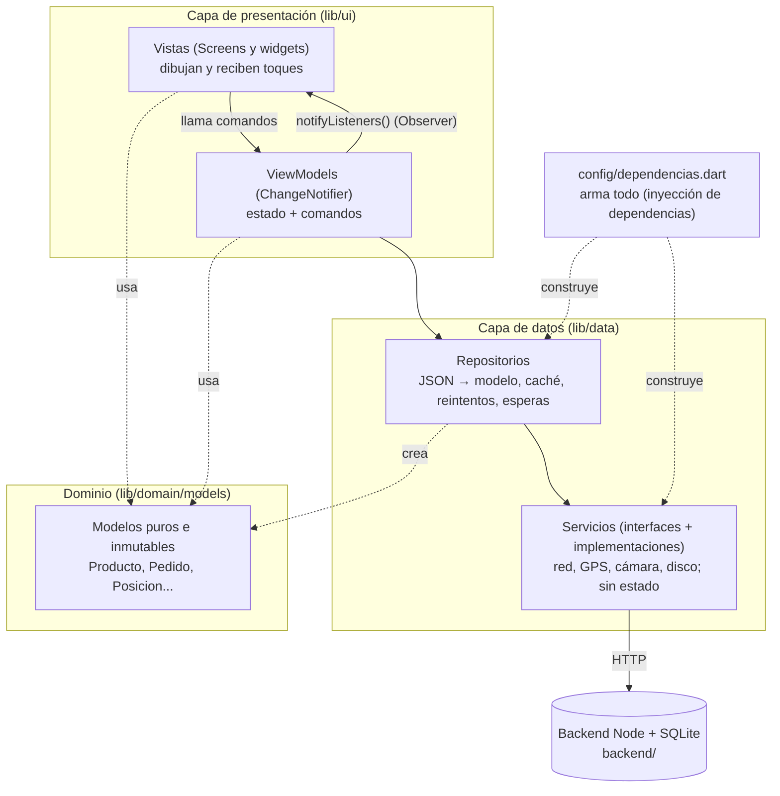
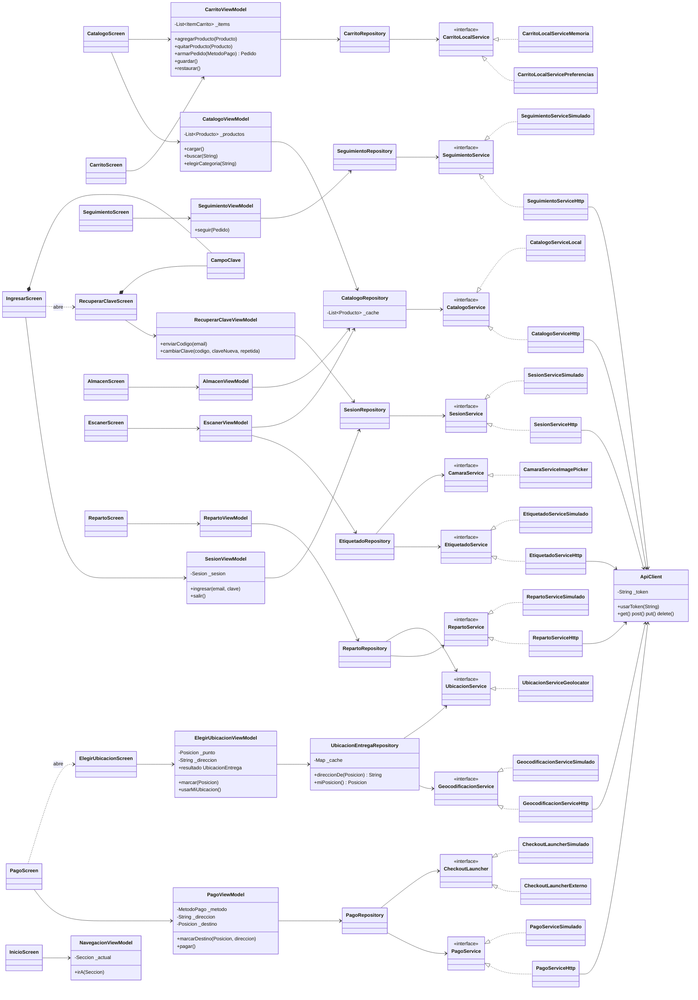
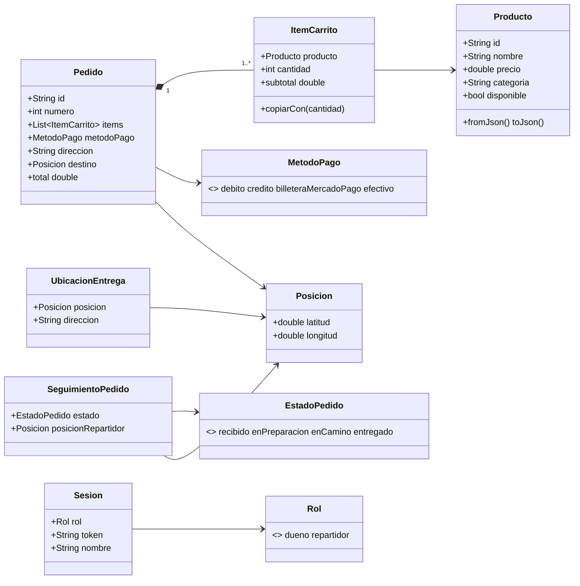
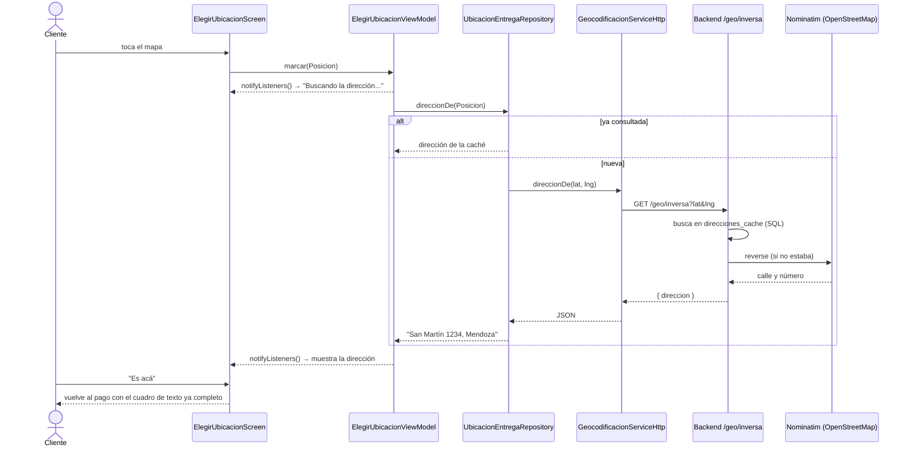
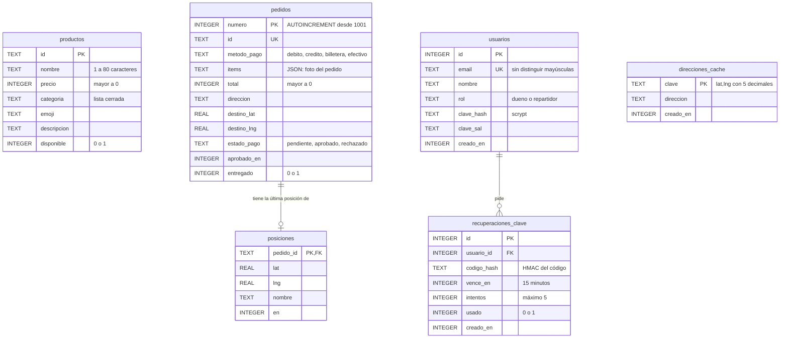

# Arquitectura de FreshMarket

Este documento muestra **cada clase en su capa**, cómo se conectan, el
modelo de datos SQL y cómo se recorre el ciclo completo de una acción.
Los diagramas están en Mermaid: GitHub y VS Code los dibujan solos.

## 1. Capas

Reglas que se cumplen en todo el proyecto (y que se pueden verificar con
`grep`):

| Regla | Cómo se verifica |
|---|---|
| Ninguna vista habla con la red | `grep -rn "ApiClient\|http\." lib/ui` no devuelve nada |
| Ningún ViewModel importa `material.dart` ni recibe `BuildContext` | `grep -rln "material.dart" lib/ui/*/view_models` no devuelve nada |
| Ningún ViewModel importa la capa de servicios | `grep -rn "data/services" lib/ui/*/view_models` no devuelve nada |
| Los servicios no guardan estado de la app | Solo los simulados, que hacen de "servidor" (está comentado en cada uno) |
| Los repositorios no dependen entre sí | Cada uno recibe solo servicios en su constructor |
| Encapsulamiento: estado privado, getters públicos, listas inmutables hacia afuera | Todos los campos que cambian empiezan con `_`; `items` devuelve `List.unmodifiable` |

## 2. Diagrama de clases

Para que se lea, cada interfaz de servicio aparece con sus
implementaciones (real y simulada) y cada pantalla con su ViewModel.

### Modelos de dominio

## 3. Ciclo completo: tocar el mapa y que aparezca la dirección

## 4. MVC y MVVM

La materia usa **MVVM**, que es la forma en que Flutter recomienda aplicar
la idea de **MVC** (Modelo–Vista–Controlador). Se corresponden así:

| MVC | En FreshMarket (MVVM) | Qué hace |
|---|---|---|
| **Modelo** | `domain/models` + `data/repositories` + `data/services` | Los datos y las reglas para obtenerlos y guardarlos |
| **Vista** | `ui/*/widgets` (Screens) | Dibuja el estado y avisa los toques |
| **Controlador** | `ui/*/view_models` (ViewModels) | Recibe las acciones, cambia el estado y avisa a la vista |

La diferencia es **cómo se entera la vista**: en MVC clásico el
controlador le dice a la vista qué cambiar; en MVVM la vista **observa** al
ViewModel (`ListenableBuilder` + `notifyListeners()`, patrón Observer) y se
redibuja sola. Así el ViewModel no conoce ningún widget y se puede probar
sin pantalla (por eso hay pruebas de cada ViewModel con fakes).

## 5. Modelo de datos (SQL)

El esquema completo está en [`backend/sql/schema.sql`](../backend/sql/schema.sql)
y los datos iniciales en [`backend/sql/seed.sql`](../backend/sql/seed.sql).
Se crea con `cd backend && npm run bd:crear`.

`productos` y `pedidos` no tienen clave foránea a propósito: el pedido
guarda una **foto** de los productos (nombre, precio y cantidad) en
`items`, para que si Don Ceferino cambia un precio o borra un producto,
los pedidos ya hechos no cambien.
