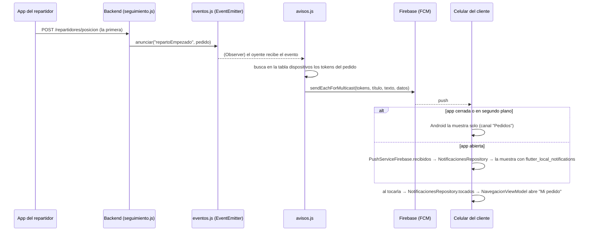

# Notificaciones push (Firebase Cloud Messaging)

Qué avisa la app, cómo viaja un aviso desde el servidor hasta la barra del
celular, cómo se configura Firebase y cómo se prueba.

## 1. Qué avisa y a quién

| Cuándo | Quién lo recibe | Título | Al tocarlo abre |
|---|---|---|---|
| Se confirma un pedido (efectivo, o pago aprobado) | Dueño y repartidores con la sesión abierta en su celular | "Nuevo pedido #1005" (con el total y la dirección) | "Mi almacén" o "Repartir" |
| El repartidor sale (manda su **primera** posición GPS) | El cliente de ese pedido | "Tu pedido #1005 está en camino" | "Mi pedido" |
| El repartidor toca "Ya lo entregué" | El cliente de ese pedido | "Tu pedido #1005 llegó" | "Mi pedido" |

Las reglas para no molestar:

- **Un aviso al salir, no uno por cada posición**: el GPS manda posiciones
  cada pocos segundos, pero el aviso "en camino" sale una sola vez.
- **Un aviso nuevo del mismo pedido reemplaza al anterior** en la barra
  ("llegó" tapa a "en camino") en lugar de apilarse (`Aviso.idNotificacion`).
- **El cliente no necesita cuenta.** Su celular se anota para **ese**
  pedido cuando el pedido se confirma.
- **Al cerrar la sesión**, ese celular deja de recibir los pedidos nuevos.

## 2. Cómo viaja un aviso



### En la app (capas)

| Capa | Clase | Qué hace |
|---|---|---|
| Servicio | `PushService` → `PushServiceFirebase` / `PushServiceSimulado` | De dónde llegan los avisos y el token del celular (patrón **Strategy**). `PushServiceFirebase` adapta `RemoteMessage` al modelo `Aviso` (patrón **Adapter**) |
| Servicio | `NotificacionLocalService` → `NotificacionLocalServicePlugin` | Mostrar el aviso en la barra (con la app abierta Android no lo hace solo), crear el canal "Pedidos" y pedir el permiso |
| Servicio | `AvisosService` → `AvisosServiceHttp` / `AvisosServiceSimulado` | Decirle al backend qué avisos quiere este celular |
| Repositorio | `NotificacionesRepository` | Une las tres piezas. Es el **sujeto**: publica `recibidos` y `tocados` |
| ViewModel | `AvisosViewModel` | **Observa** los pedidos confirmados y la sesión, y anota o borra el celular. Expone `permisoDenegado` para el cartel "Activá las notificaciones" |
| ViewModel | `NavegacionViewModel` | **Observa** `tocados` y abre la sección del aviso |
| ViewModel | `RepartoViewModel` | **Observa** `recibidos`: si llega "Nuevo pedido" mientras elige, recarga la lista solo |
| Dominio | `Aviso` (`TipoAviso.pedido` / `nuevoPedido`) | El aviso sin depender de Firebase |

### En el backend

| Archivo | Qué hace |
|---|---|
| `src/eventos.js` | Un `EventEmitter` (Observer). Pagos y seguimiento solo **anuncian**: `pedidoAprobado`, `repartoEmpezado`, `pedidoEntregado` |
| `src/avisos.js` | Escucha esos eventos, busca los tokens en la tabla `dispositivos` y manda el aviso. Si Firebase dice que un token ya no existe (app desinstalada), lo borra. Un push que falla **nunca** frena un pago ni una entrega |
| `src/push.js` | **Strategy**: con `FIREBASE_CREDENCIALES` manda por Firebase (`firebase-admin`); sin eso, escribe el aviso en la consola |
| `sql/schema.sql` | Tabla `dispositivos`: `token` + (`pedido_id` **o** `rol`, exactamente uno, con `CHECK`) |

| Ruta | Quién | Para qué |
|---|---|---|
| `POST /pedidos/:id/avisos` `{token}` | El cliente (sin cuenta) | Anotarse para ese pedido |
| `POST /dispositivos` `{token}` | Dueño o repartidor (con sesión) | Anotarse para los pedidos nuevos |
| `DELETE /dispositivos/:token` | Quien tenga el token | Darse de baja al cerrar la sesión. No pide sesión porque la app la llama **después** de cerrarla; tener el token (largo y secreto) alcanza |

## 3. Modo demo (sin backend y sin Firebase)

`flutter run` sin `URL_BACKEND` usa `PushServiceSimulado`. El
`SeguimientoServiceSimulado` hace de servidor: cuando la bici sale y cuando
llega, "manda" el aviso por ese push simulado, y la app lo muestra en la
barra igual que un push real. Así se puede mostrar en clase sin configurar
nada.

## 4. Configurar Firebase

**Ya está hecho** (07-11): proyecto **`freshmarket-itu-2026`** ("FreshMarket",
cuenta de Ignacio), app Android `com.freshmarket.freshmarket_app` y
`android/app/google-services.json` en el repo. Lo único que **no** está en el
repo es la clave del servidor: pedírsela a Ignacio y guardarla como
`backend/firebase-credenciales.json`, o hacer el paso 4 de abajo (cualquiera
con acceso al proyecto puede generar otra).

Si hubiera que armarlo de cero en otro proyecto (sin estos pasos la app
**compila y anda igual**, solo que sin push del backend: el plugin de Google
Services se aplica únicamente si existe `android/app/google-services.json`):

1. Entrar a <https://console.firebase.google.com> → **Agregar proyecto** →
   nombre `freshmarket` (Google Analytics no hace falta).
2. **Agregar app → Android**, con el nombre de paquete
   `com.freshmarket.freshmarket_app` (tiene que ser exactamente ese).
3. Descargar **`google-services.json`** y copiarlo en `android/app/`.
4. **Configuración del proyecto → Cuentas de servicio → Generar nueva
   clave privada.** Guardar el JSON como `backend/firebase-credenciales.json`
   (está en `.gitignore`: **es secreto, no se sube**).
5. En `backend/.env`: `FIREBASE_CREDENCIALES=firebase-credenciales.json`.
6. Arrancar el backend y la app con `URL_BACKEND` (ver README). Al arrancar,
   la app pide el permiso de notificaciones.

## 5. Cómo probarlo

**Automático** (sin celular ni Firebase):

```bash
flutter test test/notificaciones_test.dart   # modelo, repositorio, ViewModels
cd backend && node --test test/avisos.test.js # quién recibe qué y cuándo
```

**A mano, en el celular:**

Así se probó el 07-11 en el emulador, con el push real (ver
`INFORME_CAMBIOS_07-11.md`, sección 6):

1. Comprar algo en efectivo → en el celular del dueño (con sesión) llega
   "Nuevo pedido".
2. Con la app del cliente **cerrada**, el repartidor toca "Salir a repartir" en ese
   pedido → al cliente le llega "Tu pedido está en camino".
3. Tocar la notificación → se abre "Mi pedido" con el mapa (aunque la app
   estuviera cerrada: el pedido en curso queda guardado en el celular).
4. El repartidor toca "Ya lo entregué" → "Tu pedido llegó" reemplaza al aviso
   anterior.
5. Negar el permiso (Ajustes → Apps → FreshMarket → Notificaciones) →
   "Mi pedido" muestra "Activá las notificaciones".

## 6. Límites conocidos

- Con el backend en modo simulado (`SIMULAR_REPARTO=true`), el repartidor
  "simulado" no manda posiciones, así que no hay aviso de "en camino": ese
  aviso sale cuando un repartidor **real** manda su primera posición.
- iOS necesita además una clave APNs en Firebase y una cuenta de Apple
  Developer; no se configuró (la entrega es en Android).
- `getToken()` aparece como "deprecated" en `firebase_messaging` 17. Se usa
  a propósito porque es el token que documenta `firebase-admin` (comentado
  en `push_service.dart`).
